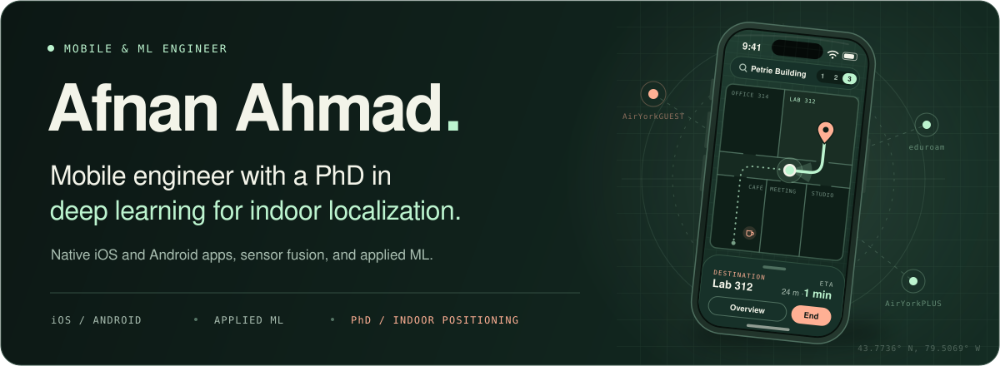
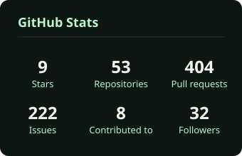
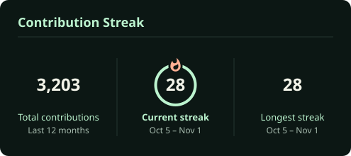
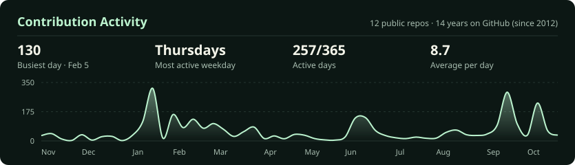
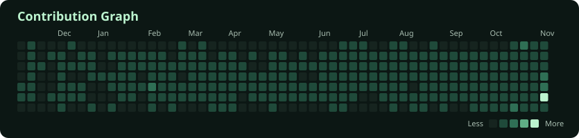
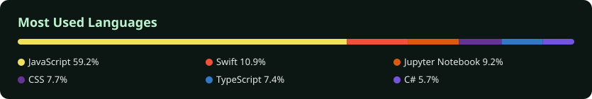

<picture>
  <source media="(max-width: 600px)" srcset="assets/header-mobile.svg" />
  
</picture>

  
  &nbsp;
  
  &nbsp;
  
  &nbsp;
  
  &nbsp;
  

## Mobile craft. Research depth.

I'm Afnan, a **Mobile & ML Engineer** with a PhD in deep learning for indoor localization. I build native mobile apps and work on the intelligence behind them, connecting software with signals, sensors, and the physical world.

<table>
  <tr>
    <td width="33%" valign="top">
      01 / MOBILE
      <h3>Native experiences</h3>
      
iOS and Android apps, with a focus on architecture, sensor integration, positioning, and AR.

      Swift · SwiftUI · UIKit · Kotlin
    </td>
    <td width="33%" valign="top">
      02 / MACHINE LEARNING
      <h3>Adaptive intelligence</h3>
      
Deep learning and sensor fusion for indoor localization, with models that adapt as signals change.

      Python · PyTorch · TensorFlow
    </td>
    <td width="33%" valign="top">
      03 / FULL-STACK
      <h3>Connected products</h3>
      
The web interfaces, APIs, and infrastructure that bring a mobile product together.

      TypeScript · Vue · Nuxt · Docker
    </td>
  </tr>
</table>

## Tools of the trade

<table>
  <tr>
    <th align="left">Area</th>
    <th align="left">Languages &amp; tools</th>
  </tr>
  <tr>
    <td><b>Mobile</b></td>
    <td>
       
      Swift · Objective-C · SwiftUI · UIKit · Kotlin · Java · Android Studio · Firebase
    </td>
  </tr>
  <tr>
    <td><b>ML &amp; data</b></td>
    <td>
       
      Python · PyTorch · TensorFlow · scikit-learn · OpenCV · MATLAB
    </td>
  </tr>
  <tr>
    <td><b>Web &amp; APIs</b></td>
    <td>
       
      TypeScript · JavaScript · Vue · Nuxt · Tailwind · Rails · Flask · PHP
    </td>
  </tr>
  <tr>
    <td><b>Infrastructure</b></td>
    <td>
       
      PostgreSQL · MongoDB · Docker · AWS · Linux · Git
    </td>
  </tr>
</table>

## GitHub activity

  
  

  

<!-- Desktop profiles already show GitHub's own graph; only phones get this one -->
<picture>
  <source media="(min-width: 601px)" srcset="assets/blank.svg" />
  
</picture>

  

  

  

